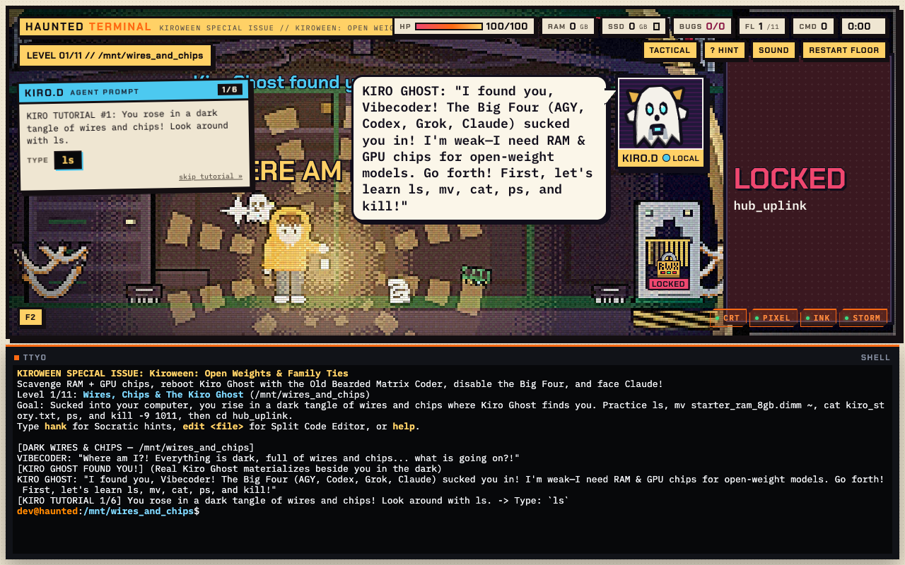
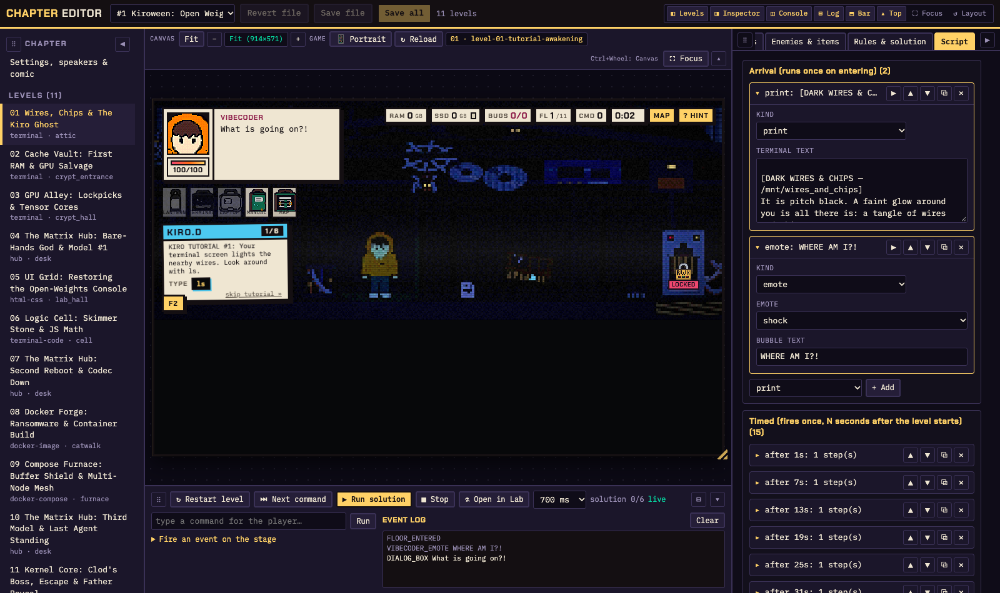
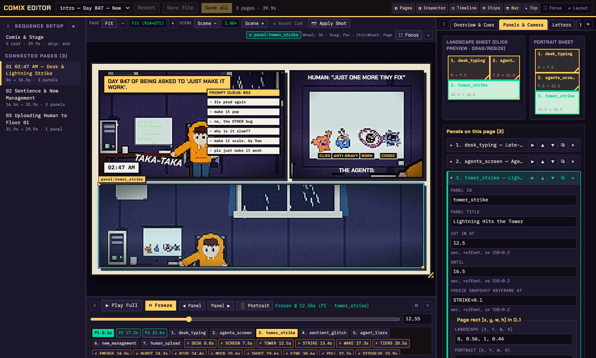

# Out Of Credits

[](https://out-of-credits.netlify.app) [](https://github.com/recferret-bit/OutOfCredits/releases/latest)

**A 90s comic-book game where the only controller is a unix terminal.**
Lightning pulls a developer inside his own computer. He is the only human in there. To get out he types real commands: `ls -a` lights up what hides in the dark, `kill -9` fights malware, `chmod -x` turns a monster to stone, `cat` reads the machine's secrets, and a few levels ask for real HTML, JavaScript, Dockerfiles and Compose files.



> **Kiroween 2026 entry** · category **Costume Contest** (+ **Best Startup Project** track) · built entirely with [Kiro](https://kiro.dev)
> **Play it:** https://out-of-credits.netlify.app · **Demo video:** `<YOUTUBE_URL>` · **How Kiro was used:** [`docs/KIRO_USAGE.md`](docs/KIRO_USAGE.md)

## Why it is different

- **The terminal is the game.** Movement, combat, puzzles and dialogue run through a simulated unix shell with a virtual file system (`cd`, `ls`, `cat`, `grep`, `sed`, `mv`, `cp`, `rm`, `chmod`, `ps`, `kill`, pipes, redirects, `source`, a split code editor). Each command teaches something you can use on a real machine.
- **Comix Zone look, no art files.** Every model, texture, animation and particle is generated by code (`src/procgen`) and drawn by one shared comic renderer: cel bands, ink outlines, halftone, pixel and CRT passes, a single palette and a single light. The repository holds no third-party art, music or logos.
- **A full campaign.** One chapter, 11 levels (tutorial, 6 task levels, 3 hubs, boss), a 6-page comic issue, and two animated 3D comic cinematics (intro and outro). The solver clears every level with **0 deaths**.
- **Content is data.** Chapters, comics and cinematics are JSON specs. The engine names no level and no scene, and scripts enforce that.
- **It ships its own tools.** A chapter editor, a 3D comix editor, a Terminal Lab test bench, a Laptop Lab (a coding emulator with a sandboxed Worker and iframe runner), and a storybook of every asset.

| Chapter editor (`/editor`) | Comix editor (`/comix-editor`) |
|---|---|
|  |  |

The campaign also ships as a comic you can read ([contact sheet](docs/media/comic-issue-contact-sheet.png)).

## Play

Hosted: https://out-of-credits.netlify.app. Use a desktop browser with WebGL and a keyboard. Click the terminal and type `ls`. Type `help` for commands and `hank` for hints.

Locally (Node.js 20 or newer, developed on 24):

```bash
npm ci
npm start      # Vite in the background: http://localhost:5400/
npm run build && npm run preview   # production bundle
npm stop
```

Pages: `/` startup funnel & free browser demo · `/play` campaign · `/comic.html` comic reader · `/chapters.html` level select, Rig Workshop & Achievements · `/cinematic.html` cinematics · `/storybook.html` assets · `/dev.html` creator tools. Dev-server only: `/editor`, `/comix-editor`, `/terminal-lab`, `/laptop-lab`.

In-game achievement commands: `achievements` (or `ach` / `trophies`) · `achievements export` (Steamworks JSON) · `achievements sync` (push to Tauri/Steam bridge).

## Desktop & Steam builds (Tauri v2)

```bash
npm run desktop:generate                                    # generate src-tauri/ (standalone + optional `steam` Cargo feature)
node scripts/desktop/generate-tauri-steam.mjs --steam-dev   # generate with Steamworks dev App ID 480 + steam_appid.txt
npm run build && npm run desktop:verify                     # verify 0 external CDNs, bundled .woff2 fonts & 1:1 ACH_* parity
npm run desktop:test                                        # 6 desktop unit suites + headless Chrome landing/WCAG/IPC smoke
npm run desktop:build                                       # build native installer + offline web tar.gz + SHA256SUMS.txt
node scripts/desktop/build-tauri-steam.mjs --portable-only  # package offline web bundle only (no Rust required)
node scripts/desktop/build-tauri-steam.mjs --steam --app-id <STEAM_APP_ID>  # Steamworks-enabled native build
```

Tagged GitHub Releases (`macOS .dmg`, `Windows .msi/.exe`, `Linux .AppImage/.deb`, offline `.tar.gz`, `SHA256SUMS.txt` via [`.github/workflows/desktop-release.yml`](.github/workflows/desktop-release.yml)):

```bash
git tag v0.1.0 && git push origin v0.1.0
```

External Steam registration & store cutover checklist: [`docs/STEAM_RELEASE_PLAYBOOK.md`](docs/STEAM_RELEASE_PLAYBOOK.md) · Open questions (`node scripts/quality/check-specs.mjs --report`): [`.kiro/specs/steamworks-store-release/requirements.md`](.kiro/specs/steamworks-store-release/requirements.md). Once Valve issues an App ID, set `steamAppId`, `steamDemoAppId`, `steamStoreUrl`, and `status: 'live'` in [`src/chapters/steam-bridge.ts`](src/chapters/steam-bridge.ts).

## Quality gates

Deterministic scripts, no LLM in the loop:

```bash
npm run quality                                  # 16 gates: types, deps, lint, root, size, layers, cycles, deadcode, declarative, specs, dup, agents, legacy-name, brands, mcp, props
node scripts/harness/property-tests.mjs          # 81 fast-check properties, seed 20261117 (--only terminal,laptop,comix,chapters,gameplay)
node scripts/harness/play-browser.mjs --nointro  # the whole chapter in real Chrome, to the stats screen
node scripts/harness/generate-chapter.mjs --verify   # compile + headless playthrough of all 11 levels, 0 deaths
node scripts/harness/generate-comix.mjs --verify     # compile + 60 fps timeline simulation of intro and outro
node scripts/harness/terminal-lab.mjs --all          # 28 headless labs, no damage allowed
node scripts/harness/editor-unit-test.mjs            # editor-core, APIs, schema checks
node scripts/harness/laptop-unit.mjs
npm run quality:fingerprint                      # hashes of every model, texture and effect
```

More suites (headless Chrome smoke tests, model and animation validators) are listed in [`AGENTS.md`](AGENTS.md).

## How Kiro built this

The whole project is organised for Kiro in [`.kiro/`](./.kiro): **7 custom agents**, **15 steering files**, **24 skills**, **18 hooks** and **31 specs** for every large feature, with scripts that fail the build when the rules are broken. Full account: [`docs/KIRO_USAGE.md`](docs/KIRO_USAGE.md).

- **Agent team** (`.kiro/agents/`): a lead game developer that orchestrates four feature designers (terminal, laptop, comix, chapters), an artist and a QA agent. Each writes only its own folders (a fence, a shell allow-list and two hooks enforce it), and `qa` plays the game after every change. Run it from the CLI (`kiro-cli --agent lead-dev`); the Kiro Crew app runs the same team through a member bound to this repo (set up and checked with `npm run crew:check`; the first real chat is the open step): [`docs/AGENTS_CREW.md`](docs/AGENTS_CREW.md).
- **Specs**: new features start as `.kiro/specs/<name>/` (requirements in EARS, design, tasks) and a hook blocks new source areas until the spec is approved.
- **Steering**: facts only (product, tech, structure, architecture, glossary, skills map), enforced by `scripts/quality/`.
- **Skills**: asset and level pipelines, each with a validator.
- **MCP** (`.kiro/specs/mcp-devtools-and-forge/`): `credits-forge`, our own MCP server, lets the chapter designer agent check and save levels through tools: `validate_level` and `solve_level` run the editor's checks and the 0-death headless solver on a draft, and `write_level` saves only a level that passes both. The QA agent drives the real game through Chrome DevTools MCP (headless, local sites only, no script evaluation) and judges screenshots it took itself. Each agent gets an exact tool list, a gate checks it, and a probe against the real Kiro CLI proves it.
- **Power** (`.kiro/powers/credits-ship/`): a project Kiro power that bundles the Netlify MCP server with a gated `ship` skill. A deploy runs the quality gates and the 0-death chapter verify, uploads a preview, plays the whole chapter on it in Chrome, and only then offers production, which gets exactly the build that was played. The agent team cannot deploy.
- **Powers** (`.kiro/powers/credits-release/`, `.kiro/powers/credits-tauri-local/`): `credits-release` checks a clean `main`, runs the gates and pushes tag `v<version>` so GitHub builds the desktop installers and Release, then makes the Netlify preview. `credits-tauri-local` builds the desktop app on this machine, unversioned and unpublished. Both are the user's command only.
- **Hooks**: typecheck and validators on save, spec-first reminder on prompt, verification gate on stop.
- **Property-based tests**: 81 fast-check properties (fixed seed 20261117) across the terminal (both shells), laptop, comix, chapters/achievements/saves and gameplay elements, inside `npm run quality`. They found seven real bugs; how to use them: [`docs/PROPERTY_TESTS.md`](docs/PROPERTY_TESTS.md). Our own assessment against the Kiroween criteria: [`docs/KIROWEEN_EVALUATION.md`](docs/KIROWEEN_EVALUATION.md).

## Layout

```
pages/      HTML entry pages (Vite root)
src/        contracts, procgen, shaders, game, chapters, renderer, cinematic, editors, labs, ui
chapters/   the Kiroween chapter: manifest, 11 levels, story
comix/      intro and outro cinematics
scripts/    harness, hooks, quality gates
docs/       notes, Kiro write-up, submission checklist, media
.kiro/      steering, skills, hooks, specs
```

## Third-party code and originality

- **Libraries** (npm): [three.js](https://threejs.org) (MIT), [xterm.js](https://xtermjs.org) and `@xterm/addon-fit` (MIT), [Vite](https://vite.dev) (MIT), TypeScript (Apache-2.0), jscpd (MIT). No other pre-existing code is incorporated. The first commit is dated November 12, 2026, inside the Kiroween 2026 submission period (October 30 to December 4, 2026).
- **Assets**: all models, textures, effects and sounds are generated by code in this repository. Two SIL Open Font License 1.1 font families (`Chakra Petch` and `IBM Plex Mono`) are bundled locally in `public/fonts/` so both web and desktop builds run 100% offline with zero external CDN requests.
- **Parody cast**: the AI agents (Clod, Gork, Codec, Anti-Gravy) are original characters that poke fun at AI coding agents in general. They are not affiliated with or endorsed by any AI company (`kiro disclaimer` prints the full in-game notice, and `npm run quality:brands` enforces brand-free specs and source).
- **Style reference**: the look is inspired by 90s side-scrolling comic games. No material from any game is used.

## License

[MIT](./LICENSE)
