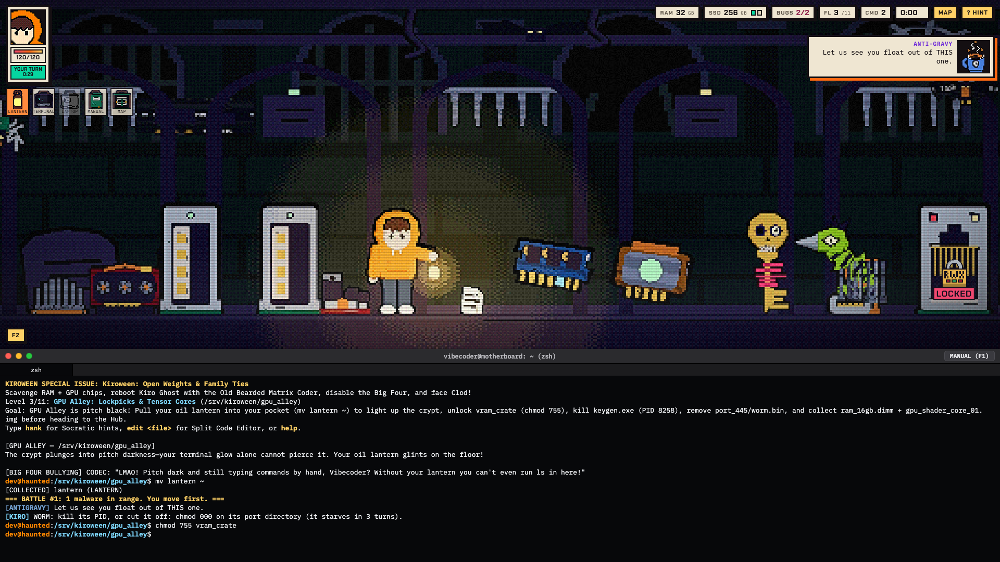
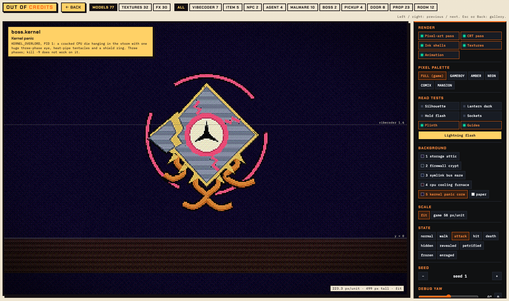
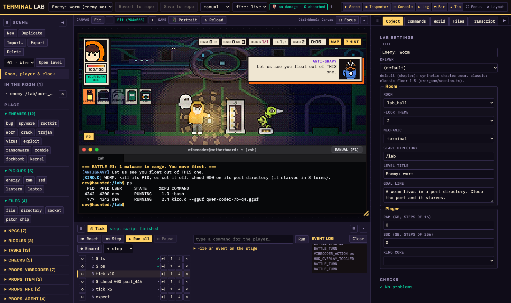
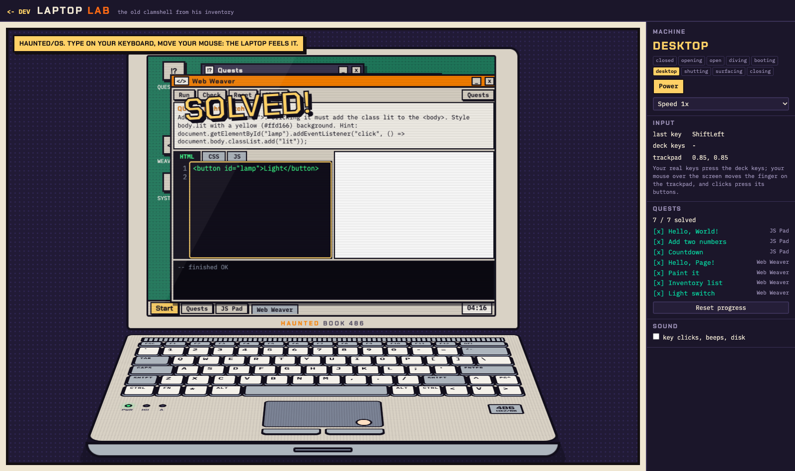
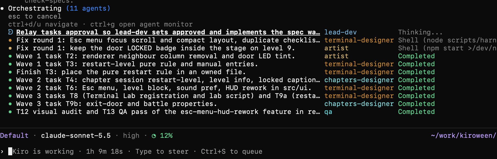

# Out Of Credits

[](https://out-of-credits.netlify.app) [](https://github.com/recferret-bit/OutOfCredits/releases/latest) [](./LICENSE)

**A 90s *Comix Zone*-style comic-book game where the only controller is a Unix terminal.**
Lightning pulls a developer straight through his CRT into his own motherboard. He is the only human inside the machine. To escape, he types real commands: `ls` lights up dark silicon with terminal phosphor glow, `mv` pockets RAM sticks and GPU chips, `kill -9` zaps live malware PIDs, `chmod -x` turns trojans to stone, `cat` and `grep` uncover system secrets, and later sectors demand real HTML, CSS, JavaScript, Dockerfiles, and Compose files.


> **Kiroween 2026 entry** · category **Costume Contest** (+ **Best Startup Project** track)
> **Play free in browser:** https://out-of-credits.netlify.app · **Demo video:** `<YOUTUBE_URL>` · **Full Kiro log:** [`docs/KIRO_USAGE.md`](docs/KIRO_USAGE.md) · **Steam playbook:** [`docs/STEAM_RELEASE_PLAYBOOK.md`](docs/STEAM_RELEASE_PLAYBOOK.md)

---

## Why Out Of Credits is different

- **The terminal is the only game controller.** Movement, exploration, door locks, turn-based combat, inventory, and dialog all run through a simulated Unix shell (`cd`, `ls`, `cat`, `grep`, `sed`, `mv`, `cp`, `rm`, `chmod`, `ps`, `kill`, pipes, redirects, `source`, a split code editor, `manual` / `F1`, `map` / `F3`, and 6 switchable OS terminal skins via `skin <id>`).
- **Turn-based malware battles.** Zero real-time damage panic: encountering hostile processes triggers a comic battle intro (an agent of the fictional Big Four taunts, Kiro Ghost advises, *FIGHT!*), the player always acts first, every non-empty Enter is answered by one enemy turn, and a 30-second turn timer ticks down (freezing cleanly inside the split code editor and laptop).
- **1995 *Comix Zone* look, 100% procedural code.** Every character, enemy, room, texture, animation, and particle FX (`77` models, `32` textures, `31` FX, `12` room kinds) is generated by code in `src/procgen/` and drawn through one shared cel, ink-outline, halftone, pixel, and CRT shader pipeline with zero third-party art files.
- **Complete 11-level campaign.** 1 awakening tutorial, 6 task sectors (filesystem, HTML/CSS, JS, Docker, Compose), 3 Matrix Hubs to reboot Kiro Ghost onto open-weight models (`qwen`, `mistral`, `deepseek`, `llama`), and 1 PID 1 Kernel Boss—plus a 6-page readable [comic issue](docs/media/comic-issue-contact-sheet.png) and real-time 3D `intro` and `outro` cinematics. Every level clears headlessly with **0 deaths**.
- **Built-in creator studios & emulators.** Alongside the game, the repo ships a **Chapter Editor** (`/editor`), **3D Comix Editor** (`/comix-editor`), **Terminal Lab** (`/terminal-lab`), **Laptop Lab** (`/laptop-lab`), and **Asset Storybook** (`/storybook.html`).

---

## Screenshots: Gameplay, Studios & Test Labs

### Gameplay — Turn-Based Terminal Combat (`/play`)

Sector 03 (*GPU Alley*) running with the lantern item lit, five-slot inventory strip, Anti-Gravy dialog box, live `YOUR TURN 0:29` battle clock, skeleton key + worm malware, and the macOS iTerm2 terminal bezel. Also ships with a full 6-page comic issue ([contact sheet](docs/media/comic-issue-contact-sheet.png)).



### Studios, Emulators & Asset Lab

| Asset Storybook (`/storybook.html`) | Terminal Lab (`/terminal-lab`) |
|---|---|
|  |  |
| **Interactive 3D PCG gallery.** Inspects all `77` procedural models, `32` textures, and `31` FX under live pixel/CRT/ink shaders, silhouettes, dark-lantern lighting, and attack/death poses. | **Deterministic terminal & puzzle test bench.** Place 12 enemy types, pickups, riddles, and NPCs, record or step scripts (`31` `.lab.json` fixtures) with zero damage absorbed (`no damage`), and compare browser vs Node transcripts. |

| Laptop Lab (`/laptop-lab`) | Chapter Lab / Editor (`/editor`) |
|---|---|
|  |  |
| **Sandboxed coding laptop emulator.** Full lid/boot/BIOS/desktop state machine with real keyboard & trackpad telemetry. Runs player JS in an isolated Worker and HTML/CSS in a `sandbox="allow-scripts"` iframe with loop guards across 7 quests. | **Schema-driven campaign studio.** Edits `chapters/<slug>/` JSON specs with live `/play?draft=1` preview, 8-tab typed forms, cross-reference checks, conflict-safe etag `409` saves, and one-click headless 0-death chapter solving. |

| Comix Lab / Editor (`/comix-editor`) |
|---|
|  |
| **3D animated comix choreographer.** Edits `comix/<slug>/` multi-page specs with bidirectional 2D layout mini-maps (Landscape & Portrait sheets), orthographic camera controls, keyframe scrubber, and 60 fps timeline verification. |

---

## Play

- **Browser (live):** Open https://out-of-credits.netlify.app in a desktop browser with WebGL and a keyboard. Click the terminal, type `ls`, and press Enter.
- **Helpful in-game commands:** `help` · `hank` (Socratic hints) · `manual` or `F1` (hardcover Field Manual) · `map` or `F3` (interactive PCB Motherboard Map) · `inventory` / `hold <item>` · `skin <id>` · `restart-level` · `achievements` · `kiro disclaimer`.

**Run locally** (Node.js 20+, developed on Node 24):

```bash
npm ci
npm start                         # Background Vite server at http://localhost:5400/
npm run build && npm run preview  # Production bundle check
npm stop
```

**Routes:**
- **Player pages:** `/` (launch funnel & free browser demo) · `/play` (campaign) · `/comic.html` (comic issue reader) · `/chapters.html` (sector select, Rig Workshop, Bestiary & Achievements) · `/cinematic.html` (3D intro/outro comixes) · `/manual` (`F1` Field Manual) · `/desktop.html`, `/achievements.html`, `/comix.html` (landing tabs) · `/storybook.html` (procedural asset gallery) · `/dev.html` (creator index)
- **Dev-server studios & labs:** `/editor` · `/comix-editor` · `/terminal-lab` · `/laptop-lab`

---

## Desktop Builds (Tauri v2) & Steamworks Integration

Out Of Credits uses a zero-CAC **browser-demo-to-Steam conversion funnel** backed by a native **Tauri v2** shell and optional Rust **Steamworks** bindings (`steamworks = "0.11.0"`):

- **100% offline native bundles:** `npm run desktop:generate` (`scripts/desktop/generate-tauri-steam.mjs`) synthesizes git-ignored `src-tauri/` and app icons (`~4 MB` macOS `.dmg`, `< 15 MB` Windows `.msi` / `-setup.exe`, Linux / Steam Deck `.AppImage` / `.deb`, plus a zero-Rust `--portable-only` `.tar.gz` web bundle with `SHA256SUMS.txt`). `npm run desktop:verify` rejects any external CDN URL and verifies self-hosted SIL OFL 1.1 `.woff2` fonts (`public/fonts/`). Launches full screen by default (`F11` / Esc toggle).
- **13 `ACH_*` Steamworks achievements (1:1 parity):** Every trophy in [`src/chapters/achievements.ts`](src/chapters/achievements.ts) maps 1:1 to a Steamworks API key (`ACH_FIRST_BOOT` through `ACH_ZERO_PANIC_RUN`, verified by `desktop:verify` and `desktop:test`). In-game commands: `achievements`, `achievements export` (Steamworks JSON), and `achievements sync` (push to the Tauri/Steam bridge).
- **Portable JSON saves & Steam Auto-Cloud:** Web players export `out-of-credits-save.json` from `/` and import it into the desktop build. Tauri persists saves and trophy ledgers atomically in `app_data_dir` (`dev.outofcredits.app`) so **Steam Auto-Cloud** (`*.json`) carries progress across Windows, macOS, Linux, and between the free Steam Demo App and Full Main App.
- **Automated multi-OS releases & Steam cutover:** Pushing a `v*` tag triggers [`.github/workflows/desktop-release.yml`](.github/workflows/desktop-release.yml) to run `npm run quality`, `generate-chapter.mjs --verify`, desktop verification, and publish all OS installers + `SHA256SUMS.txt` to GitHub Releases. Once Valve assigns App IDs (checklist in [`docs/STEAM_RELEASE_PLAYBOOK.md`](docs/STEAM_RELEASE_PLAYBOOK.md), draft spec [`.kiro/specs/steamworks-store-release/`](.kiro/specs/steamworks-store-release/requirements.md)), flipping `steamAppId`, `steamDemoAppId`, `steamStoreUrl`, and `status: 'live'` in [`src/chapters/steam-bridge.ts`](src/chapters/steam-bridge.ts) switches every Wishlist CTA on `/` directly to the Steam store page.

```bash
npm run desktop:generate                                                   # generate src-tauri/ (standalone + optional `steam` Cargo feature)
node scripts/desktop/generate-tauri-steam.mjs --steam-dev                  # include Steamworks dev App ID 480 + steam_appid.txt
npm run build && npm run desktop:verify                                    # verify 0 external CDNs, bundled .woff2 fonts & 1:1 ACH_* sync
npm run desktop:test                                                       # desktop unit suites + headless Chrome landing/WCAG/IPC smoke
npm run desktop:build                                                      # native installer + portable offline tar.gz + SHA256SUMS.txt
node scripts/desktop/build-tauri-steam.mjs --portable-only                 # portable offline web bundle only (no Rust required)
node scripts/desktop/build-tauri-steam.mjs --steam --app-id <STEAM_APP_ID> # live Steamworks SDK build staging libsteam_api
git tag v0.1.0 && git push origin v0.1.0                                   # trigger GitHub Actions multi-OS desktop release
```

---

## `.kiro/` Architecture: Every Kiro Feature & How It Works

Out Of Credits follows **"Roles Don't Blur"** ([`docs/kiro-best-practice.md`](docs/kiro-best-practice.md)): **facts** stay in steering, **capabilities** in specs, **procedures** in skills, **truth** in typed JSON schemas, **people** in custom agents, and **enforcement** in deterministic Node scripts and hooks rather than prose.

| Kiro Feature | Location | Count | How It Works |
|---|---|---|---|
| **Custom Agents & Crew** | [`.kiro/agents/`](.kiro/agents/) | **9** agents | Generated from one table in [`scripts/harness/agents-build.mjs`](scripts/harness/agents-build.mjs); strict 1-owner-per-file `fs_write` fences, shell allow + catch-all `deny *`, `PreToolUse` & `Stop` hooks |
| **Specs & Spec-First Grill** | [`.kiro/specs/`](.kiro/specs/) | **41** specs | 36 top-level + 5 `inventory/items/*` specs (`lantern`, `laptop`, `manual`, `map`, `terminal`); EARS requirements + interactive grill (`draft` → `done`) |
| **Steering** | [`.kiro/steering/`](.kiro/steering/) | **15** files | 8 always-on (`product`, `tech`, `structure`, `architecture`, `glossary`, `skills-map`, `spec-first`, `team`) + 7 `fileMatch` path-scoped rules |
| **Skills** | [`.kiro/skills/`](.kiro/skills/) | **63** skills | Tagged `[WORKFLOW]` (1), `[ASSET PCG]` (14), `[LEVEL GEN]` (9), `[AUDIO]` (37), `[SOCIAL]` (2), paired with deterministic validators |
| **Hooks** | [`.kiro/hooks/`](.kiro/hooks/) | **18** + **27** | 18 workspace hooks (`UserPromptSubmit`, `PreToolUse`, `PostFileSave`, `Stop`) + 3 lifecycle hooks per agent (`SessionStart`, `PreToolUse`, `Stop`) |
| **Scoped MCP Servers** | [`scripts/mcp/credits-forge/`](scripts/mcp/credits-forge/) | **2** + **1** | `credits-forge` + headless `chrome-devtools-mcp` bound per agent (`qa` & designers only); `.kiro/settings/mcp.json` stays empty; `@netlify/mcp` inside `credits-ship` |
| **Project Powers** | [`.kiro/powers/`](.kiro/powers/) | **3** powers | `credits-ship` (Netlify), `credits-release` (`v*` tag + Release + preview), `credits-tauri-local` (local native build) — human-only, denied to agent shells |
| **Property Tests & Gates** | [`scripts/quality/`](scripts/quality/) | **87** + **16** | 87 `fast-check` properties (seed `20261117`) + 16 deterministic gates in `npm run quality` + multi-viewport CDP `visual-audit.mjs` + asset `fingerprint.mjs` |

### 1. Declarative Multi-Agent Orchestration & Kiro Crew (`9` Agents)

Instead of letting one unconstrained assistant edit arbitrary files, every source file, asset, chapter, sound cue, and doc in the repository has **exactly one owning agent** defined in [`scripts/harness/agents-build.mjs`](scripts/harness/agents-build.mjs). When you type a scenario into `kiro-cli --agent lead-dev` (or chat with `"Out Of Credits Lead"` in the **Kiro Crew** desktop app), `lead-dev` creates an `agent/<task>` branch, fans sub-tasks out in parallel waves to the owning specialists, sends everything to `qa` for headless Chrome & gate verification, loops up to two fix rounds, and pushes `agent/<task>` for human PR review (`main` stays protected):



Here is a real multi-wave `kiro-cli` session orchestrating **11 agent invocations** across `lead-dev`, `terminal-designer`, `artist`, `chapters-designer`, and `qa`:



**All 9 Kiro Crew Agents** (detailed permissions & setup in [`docs/AGENTS_CREW.md`](docs/AGENTS_CREW.md)):

| # | Agent | Role | Owned `fs_write` Paths | Specialized Tools, Skills & Guards |
|---|---|---|---|---|
| 1 | **`lead-dev`** | Orchestrator & git branch owner | `.kiro/{specs,steering}/**`, `src/{contracts,editor-core,play,pages,hub,styles,sandbox}/**`, `docs/*.md`, `docs/media/**`, `README.md`, visual/audio/social harness wrappers | `feature-spec-grill`, spawns only the 8 named specialists (`subagent/<name>`), commits/pushes `agent/*` only |
| 2 | **`terminal-designer`** | Unix shell, VFS, manual & Terminal Lab | `src/game/{shell,commands-*,unix-applets,tree*,manual*,lab-*}.ts`, `src/ui/**`, `src/terminal-lab/**`, `scripts/harness/terminal-lab/**`, `props/terminal*.mjs` | `chapter-level-generator`, 29 terminal properties, 31 `.lab.json` scripts |
| 3 | **`laptop-designer`** | Clamshell laptop OS, apps & Laptop Lab | `src/laptop/**`, `scripts/harness/props/laptop.mjs` | Sandboxed JS Worker + `sandbox="allow-scripts"` iframe tasks, 6 laptop properties |
| 4 | **`comix-designer`** | Animated 3D intro/outro & Comix Editor | `comix/**`, `src/cinematic/**`, `src/comix-editor/**`, `scripts/harness/props/comix.mjs` | 4 comix `[LEVEL GEN]` skills, `@credits-forge/list_assets`, 60 fps verifier, 5 comix properties |
| 5 | **`chapters-designer`** | Levels, story, combat & Chapter Editor | `chapters/**`, `src/chapters/**`, `src/chapter-editor/**`, `src/game/{entities*,bestiary,puzzle,inventory,kiro*,dialogue,agents,battle}.ts`, `props/{chapters,gameplay*}.mjs` | 5 chapter `[LEVEL GEN]` skills, **`@credits-forge/write_level`** (0-death gated), 47 chapter/gameplay properties |
| 6 | **`artist`** | Procedural 3D models, rooms, shaders & FX | `src/procgen/**`, `src/shaders/**`, `src/renderer/**`, `src/storybook/**`, `src/assets/**`, `public/assets/**` | All 14 `[ASSET PCG]` skills, geometry/particle/animation validators, byte-identical refactor fingerprints |
| 7 | **`sound-designer`** | SFX, music beds, voice lines & `AppBus` audio | `public/sfx/**`, `public/music/**`, `docs/audio/*.md`, `src/audio/**`, `scripts/harness/audio-{unit,smoke}.mjs` | `sfx-and-music-pipeline` + `elevenlabs-*` skills via capped `audio-gen.mjs` (`<=15,000` credits/run, `>=30,000` reserve) |
| 8 | **`smm-agent`** | Social growth, trailers, infographics & Steam funnel | `social/*.md`, `social/{campaigns,research,media/specs}/**`, `docs/marketing/**` | `smm-revenue-playbook`, `social-video-harness` (`social-media.mjs`), ElevenLabs social VO (dry-run default) |
| 9 | **`qa`** | End-to-end playtesting & visual audit | `docs/qa/*.md`, `docs/qa/media/**`, `docs/qa/labs/**` (**zero** `src/` writes) | **Chrome DevTools MCP** (headless, URL-guarded, zero JS eval), read-only `credits-forge`, `visual-audit.mjs` |

**How agent lanes are enforced (verified on Kiro CLI 3.3+ / 3.6.2 by `npm run quality:agents`):**
- **Single source of truth:** `agents-build.mjs` compiles all 9 `.kiro/agents/*.json` profiles (`"model": "auto"`, `"allowedTools": []` so Kiro CLI never drops permission rules).
- **Hard `fs_write` fence:** Each agent carries `allow` on its own globs plus `deny` on `**` (excluding its globs), compiled `generated/**` outputs, and human-approved `docs/qa/baselines/**`.
- **Dual-written shell policy:** Under Kiro Crew Automatic mode, an unmatched command auto-approves—so every agent's `shell` allow-list is paired with an exact catch-all `deny *` excluding that allow-list, blocking `rm`, `find`, `sed -i`, `node -e`, `--output`, raw `elevenlabs`, deploys, tags, and local Tauri builds.
- **`PreToolUse` & `Stop` agent hooks:** [`scripts/hooks/agent-shell-guard.mjs`](scripts/hooks/agent-shell-guard.mjs) catches shell redirects outside own paths, `cd` + `node`, git history writes on `main`, and credit-spending commands; [`scripts/hooks/agent-scope.mjs`](scripts/hooks/agent-scope.mjs) snapshots and reports any cross-boundary edits on exit.
- **Secret isolation:** `fs_read` denies `.env*`, `*.pem`, `*.key`, `~/.ssh/**`, `~/.aws/**`, Netlify/GitHub auth configs, and `~/.kiro/crew/.env`.
- **Kiro Crew readiness:** `npm run agents:install` links the team into `~/.kiro/agents/` and `npm run crew:check` verifies Crew workspace binding, branch protection on `main`, and hook/MCP readiness.

### 2. Spec-Driven Development & Interactive Grill (`41` Specs)

Every new feature or multi-layer refactor starts as a Kiro spec in [`.kiro/specs/<name>/`](.kiro/specs/) (36 top-level folders plus 5 inventory child specs under `inventory/items/{lantern,laptop,manual,map,terminal}`):
- **Structured EARS & lifecycle:** `requirements.md` (or `bugfix.md`) uses testable EARS clauses (`WHEN / IF / WHILE ..., THE SYSTEM SHALL ...`), moving strictly through `draft` → `requirements-approved` → `design-approved` → `approved` → `done`.
- **Zero-guess grilling (`feature-spec-grill`):** Before leaving `draft`, the agent grills the user in rounds of <= 5 concrete options (each with one `(Recommended)` default and trade-off), records every user answer under `## Decisions`, and leaves unresolved items under `## Open questions`.
- **Code block gate:** [`scripts/hooks/guard-spec-first.mjs`](scripts/hooks/guard-spec-first.mjs) blocks writes to any new `src/<area>/` or `pages/<name>.html` until a spec naming it reaches `approved`, and `npm run quality:specs` rejects invalid statuses or dangling open questions.

### 3. Always-On & Path-Scoped Steering (`15` Files)

[`.kiro/steering/`](.kiro/steering/) holds concise, non-overlapping facts within Kiro's 100k-character context limit:
- **8 always-on files:** `product.md`, `tech.md`, `structure.md`, `architecture.md` (inward dependency layers + hard limits), `glossary.md` (canonical terms preventing synonym drift), `skills-map.md`, `spec-first.md`, and `team.md`.
- **7 `inclusion: fileMatch` files:** `asset-pcg-rules.md`, `level-gen-rules.md`, `declarative-chapters.md`, `declarative-comix.md`, `chapter-editor-rules.md`, `comix-editor-rules.md`, and `terminal-lab-rules.md`—loaded only when matching files are touched.
- **Declarative enforcement:** `npm run quality:declarative` rejects any chapter ID, level ID, comix sequence/page ID, or `spec.index === N` check inside engine source code.

### 4. Categorized Skills & Deterministic Validators (`63` Skills)

Every skill in [`.kiro/skills/`](.kiro/skills/) must open its front-matter description with one of five tags (`check-agents.mjs` fails on untagged skills) and pair creative instructions with deterministic Node validators:
- **`[WORKFLOW]` (1):** `feature-spec-grill` (scaffolding + grill + status gates).
- **`[ASSET PCG]` (14):** `credits-art-direction` (palette, single cel light, no bloom/shadows) + creators for kitbash 3D, malware 3D, procedural rooms, textures, shaders, comic lighting/lightning, hero/malware animations, particles, external AI mesh/sprite manifest, paired with `model-geometry-validator`, `particle-effect-validator`, `check-tags.mjs`, and `comic-panel-viewport-auditor`.
- **`[LEVEL GEN]` (9):** Ordered chains where each step consumes the previous artifact—5 for chapters (`chapter-architect-intake` → `comix-story-drawer` → `chapter-level-generator` → `chapter-implementer` → `chapter-editor`) and 4 for 3D comixes (`comix-architect-intake` → `comix-sequence-generator` → `comix-implementer` → `comix-editor`).
- **`[AUDIO]` (37):** `sfx-and-music-pipeline` + 36 `elevenlabs-*` CLI skills, routed exclusively through capped [`scripts/harness/audio-gen.mjs`](scripts/harness/audio-gen.mjs).
- **`[SOCIAL]` (2):** `smm-revenue-playbook` + `social-video-harness` (`scripts/harness/social-media.mjs` rendering declarative `.video.json`, `screenshots.spec.json`, `infographics.spec.json`, and multi-track ffmpeg mixes).

### 5. Event-Driven Hooks (`18` Workspace + `27` Agent Hooks)

[`.kiro/hooks/`](.kiro/hooks/) wires zero-LLM verification directly into every edit and turn lifecycle:
- **`UserPromptSubmit`:** `spec-first-on-prompt` injects the spec-first check when prompts describe a feature or refactor.
- **`PreToolUse`:** `guard-spec-first` blocks unapproved new modules/pages; `guard-chapter-files` protects compiled `generated/` outputs and the four-place vocabulary rule (types, interpreter, editor `schema.ts`, pack validator); plus each agent's `agent-shell-guard`.
- **`PostFileSave`:** `typecheck-on-save`, `static-analysis-on-save` (ESLint, cycles, layers, size), `validate-chapters-on-save`, `validate-comix-on-save`, `validate-labs-on-save`, `check-agents-on-save`, `check-brands-on-save`, and 4 `asset-dryrun-*` hooks (model, texture, effect, character).
- **`Stop`:** `chapter-gates-on-stop`, `spec-status-on-stop`, `property-tests-on-stop`, `quality-chain-on-stop`, plus each agent's `agent-scope` report.

### 6. Scoped Per-Agent MCP Servers

[`.kiro/settings/mcp.json`](.kiro/settings/mcp.json) stays empty so human sessions don't load specialist servers needlessly. Instead, `agents-build.mjs` wires exact `@server/tool` lists per agent (verified by `npm run quality:mcp` and live Kiro CLI probes in `scripts/harness/mcp-probe.mjs`):
- **`credits-forge` ([`scripts/mcp/credits-forge/`](scripts/mcp/credits-forge/)):** Custom stdio MCP server (`@modelcontextprotocol/sdk@1.32.2`, `zod@4.6.7`) exposing `list_assets`, `list_levels`, `get_level`, `validate_level`, `solve_level`, and `write_level`. Only `chapters-designer` has `write_level`, which refuses to write any draft that fails schema validation, headless **0-death** solving, or etag conflict checks, then atomically formats and recompiles the pack. `qa` gets read-only forge tools; `comix-designer` gets `list_assets`.
- **Chrome DevTools MCP (`chrome-devtools-mcp@1.13.0`):** Bound exclusively to `qa`, launched directly from `node_modules` with Node's compile cache in headless isolated mode, with JavaScript evaluation and `file:` navigations disabled and URLs strictly fenced to `localhost`, `127.0.0.1`, and `https://*.netlify.app/*` via `devtools-url-guard`.

### 7. Human-Only Project Powers (`3` Powers)

[`.kiro/powers/`](.kiro/powers/) packages deployment and release workflows as Kiro powers whose shell invocations are explicitly denied to every team agent:
- **`credits-ship`:** Bundles `@netlify/mcp@1.22.1` + the `ship` skill (`ship.mjs preview` / `prod`). Runs `npm run quality`, 0-death chapter verification, and production build, uploads a draft preview, plays the entire 11-level campaign on the live preview URL in real Chrome, and refuses to deploy to production unless it promotes that exact verified build after human confirmation.
- **`credits-release`:** Pre-flight checks clean `main`, matching `package.json` version and free tag, runs all gates, pushes `v<version>` so GitHub Actions builds all desktop installers, and prepares the Netlify preview.
- **`credits-tauri-local`:** Builds an unversioned local Tauri desktop bundle from the working tree into git-ignored `scripts/harness/out/tauri-local/` and launches it for human smoke testing.

### 8. Property-Based Testing (`87` Properties), Visual Audit & 16 Quality Gates

- **`87` `fast-check` properties (fixed seed `20261117`):** Across Terminal (`29`), Laptop (`6`), Comix (`5`), Chapters (`17`), and Gameplay (`30`) inside `npm run quality`. Caught **7 real bugs** that handcrafted example tests missed (`mv .. j` VFS cycle hang, `ls -l <file>` in chapter shell, `sed 's//x/g'` infinite-loop insert, `cp` permission check, level-10 core alias mismatch, draft check crashes, and `Object.prototype` pollution keys like `toString` in portable save imports). See [`docs/PROPERTY_TESTS.md`](docs/PROPERTY_TESTS.md).
- **Seeded multi-viewport visual audit (`scripts/harness/visual-audit.mjs`):** Captures every screen across `1600x950`, `1280x820`, `1920x1080`, and `1024x768` using CDP virtual clocks and `pixelmatch` diffs against human-approved `docs/qa/baselines/` (agents are denied `--update`).
- **Asset fingerprints (`npm run quality:fingerprint`):** Hashes every generated model, texture, FX, and pose so engine refactors prove zero unintended visual drift.

---

## Tools, Models & Project Origin

- **Daily development stack (`kiro-cli` & Kiro Crew — `auto`, Sonnet, Opus):**
  - **`auto` routing:** Every `.kiro/agents/*.json` team profile sets `"model": "auto"` (enforced by `npm run quality:agents`) so multi-agent Kiro Crew waves never stall on a single pinned model quota during long autonomous runs.
  - **Sonnet:** Used in `kiro-cli` for fast high-concurrency implementation waves—UI/terminal polish, shader & procedural model iteration, lab scripts, smoke harnesses, and rapid fix rounds across the 9-agent crew.
  - **Opus:** Used in `kiro-cli` for deep architectural planning, `feature-spec-grill` specifications, declarative state-machine design (`createStateMachine` & typed `AppBus`/`PlayEventBus`), security fences, MCP server contracts, and designing non-vacuous `fast-check` property invariants.
- **Initial generation & migration to Kiro:**
  - Initial project scaffolding and early prototype commits (starting **November 12, 2026**, well inside the Kiroween submission period of October 30 – December 4, 2026) were generated using **Google AGY** before receiving hackathon **Kiro bonus credits** and upgrading to a personal **Kiro subscription**.
  - Once on Kiro, the entire project migrated into `kiro-cli` and **Kiro Crew** (`auto`, Sonnet, Opus)—building out the full `.kiro/` governance architecture (`9` custom agents, `41` specs, `15` steering files, `63` skills, `18` hooks, `3` powers, `2` agent MCP servers), clean inward architecture, turn-based battles, studios/labs, audio/social harnesses, and Tauri v2 + Steamworks desktop pipeline.

---

## Quality Gates

Deterministic Node scripts with zero LLMs in the loop:

```bash
npm run quality                                  # 16 gates: tsc, deps, lint, root, size (<=600 lines/file, <=130/fn), layers, cycles, deadcode, declarative, specs, dup (0 clones), agents, legacy-name, brands, mcp, props
npm run test                                     # All unit suites + 0-death chapter verify + 60fps comix verify
node scripts/harness/property-tests.mjs          # 87 fast-check properties (--only terminal,laptop,comix,chapters,gameplay)
node scripts/harness/play-browser.mjs --nointro  # Full 11-level campaign in real Chrome to stats screen
node scripts/harness/generate-chapter.mjs --verify   # Compile + 0-death headless solver across all 11 levels
node scripts/harness/generate-comix.mjs --verify     # Compile + 60 fps timeline simulation of intro and outro
node scripts/harness/terminal-lab.mjs --all          # 31 headless Terminal Lab scenarios, 0 damage absorbed
node scripts/harness/editor-unit-test.mjs            # Editor-core, schema completeness & conflict-safe API checks
node scripts/harness/laptop-unit.mjs                 # Laptop FSM, sandboxed Worker/iframe & loop guard checks
npm run quality:fingerprint                          # Deterministic hashes of every procedural model, texture, pose & FX
```

---

## Repository Layout

```text
pages/      HTML entry pages (Vite root)
src/        contracts, audio, procgen, shaders, game, chapters, renderer, cinematic,
            editor-core, chapter-editor, comix-editor, terminal-lab, laptop, hub, ui, play
chapters/   Kiroween Chapter 1: manifest, 11 level specs, story comic & dialogs
comix/      Real-time 3D intro and outro comic sequences
social/     Declarative marketing campaigns, research & video/screenshot/infographic specs
scripts/    harness/, desktop/ (Tauri v2 + Steamworks), mcp/ (credits-forge), hooks/, quality/
docs/       Kiro write-up, Crew guide, Steam release playbook, property tests, QA reports, media/
.kiro/      agents/, steering/, specs/, skills/, hooks/, powers/, settings/
```

---

## Third-party code & originality

- **Libraries (npm, exact pinned versions enforced by `check-deps.mjs`):** [three.js](https://threejs.org) (MIT), [xterm.js](https://xtermjs.org) & `@xterm/addon-fit` (MIT), [Vite](https://vite.dev) (MIT), TypeScript (Apache-2.0), ESLint / `typescript-eslint` (MIT), `jscpd` (MIT), `fast-check` (MIT), `@modelcontextprotocol/sdk` (MIT), `zod` (MIT). No pre-existing game codebase is incorporated; first commit is November 12, 2026.
- **Visuals & Fonts:** All 3D models, rooms, textures, animations, and shaders are generated deterministically by code in `src/procgen/` and `src/shaders/`. Two SIL Open Font License 1.1 font families (`Chakra Petch` and `IBM Plex Mono`) are bundled in `public/fonts/` for 100% offline execution with zero external CDN requests.
- **Parody cast & non-affiliation:** The fictional antagonists (**Clod**, **Gork**, **Codec**, **Anti-Gravy**) are original parody characters poking fun at AI coding tools in general and are not affiliated with or endorsed by any AI company (`kiro disclaimer` prints the full in-game notice, and `npm run quality:brands` enforces brand-free specs and source). Inspired artistically by 90s side-scrolling comic games; zero assets from any external game are used.

## License

[MIT](./LICENSE)
