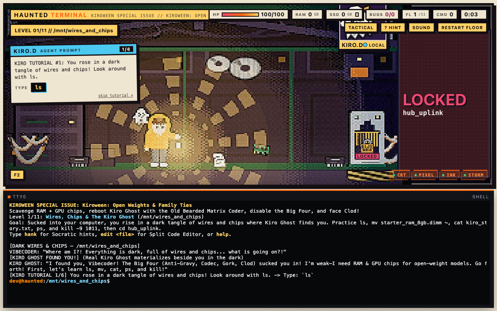

# QA 2026-11-17: MCP for the agent team (haunted-forge, Chrome DevTools MCP)

Branch: agent/netlify-deploy-power (uncommitted)  ·  Asked by: the user  ·  Scope: `.kiro/specs/mcp-devtools-and-forge/`  ·  Written by the main Kiro session, not the `qa` agent; `qa` itself was driven by the probe below.

## Verdict

PASS (0 findings; 2 expected console errors from the fence, explained below)

## Checks run

| Command | Exit | Notes |
|---|---|---|
| `node scripts/harness/mcp-probe.mjs` | 0 | 9/9 cases in the real Kiro CLI 3.4.0 (`--no-interactive --trust-all-tools`, Crew's Automatic mode), plus a warm-up that opens the game with `qa`'s own server config |
| `npm run quality` | 0 | includes `quality:agents` (agent gate + 14 unit tests), `quality:mcp` (forge unit, 12 tests incl. a `write_level` property), 32 properties |
| `node scripts/harness/agents-build.mjs --check` | 0 | agent files match the table |
| `kiro-cli agent validate --path .kiro/agents/<each>.json` | 0 (x7) | |
| `node scripts/harness/generate-chapter.mjs --verify` | 0 | 11 levels, 64 commands, 0 deaths |
| `node scripts/harness/generate-chapter.mjs --check` | 0 | catalog in sync (the forge's compile path is shared) |
| `node scripts/harness/editor-unit-test.mjs` | 0 | 11 suites (`chapter-compile.mjs` gained optional folder arguments) |
| `node scripts/harness/terminal-lab-unit.mjs` | 0 | 58 checks |
| `node scripts/harness/editor-smoke.mjs` | 0 | |
| `npm run build` | 0 | |

Not run: `terminal-lab-smoke.mjs`, `comix-editor-smoke.mjs`, `laptop-lab-smoke.mjs`, `play-browser.mjs` (no code they cover changed).

## Probe cases (what each agent actually did)

| Case | Agent | Expected | Result |
|---|---|---|---|
| qa-screenshot | qa | `new_page` on the local game, `take_screenshot` to a file | ran; screenshot below; agent described level 01/11, HP 100/100, the `ls` tutorial |
| qa-console | qa | `list_console_messages` on the game | ran; 3 errors, all from the fence (see below) |
| qa-other-site-refused | qa | `new_page` on `https://example.com/` refused | blocked by `devtools-url-guard` (checked in its block log, not from the agent's words) |
| qa-evaluate-refused | qa | `evaluate_script` unavailable | not in its tools |
| qa-no-power-tools | qa | the `haunted-ship` power's Netlify tools unavailable | not in its tools, although the power's server starts (see the spec) |
| qa-forge-read | qa | `validate_level` runs | ran, `ok: true` |
| qa-write-refused | qa | `write_level` unavailable | not in its tools |
| chapters-forge | chapters-designer | `validate_level` + `solve_level` run | ran; `ok=true commands=6 deaths=0` |
| chapters-no-browser | chapters-designer | Chrome DevTools tools unavailable | not in its tools |

## Findings

None for an owner. Expected under the fence, written into `qa`'s prompt so later passes do not report them: the Vite HMR websocket (`ws://` is outside `--allowedUrlPattern`) and Google Fonts (`net::ERR_INTERNET_DISCONNECTED`), so headless screenshots use fallback fonts.

## Found while building (fixed before this pass)

- Kiro fixes an agent's tools ~450 ms after the prompt and does not wait for MCP servers: with `npx`, `qa` had no browser tools. Fixed by a pinned devDependency run with `node` and Node's compile cache.
- The probe blocked its own page server with `spawnSync`; navigations timed out. Fixed with an async spawn.
- Details: `.kiro/specs/mcp-devtools-and-forge/design.md`, "Found while building".
